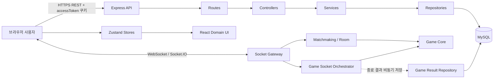
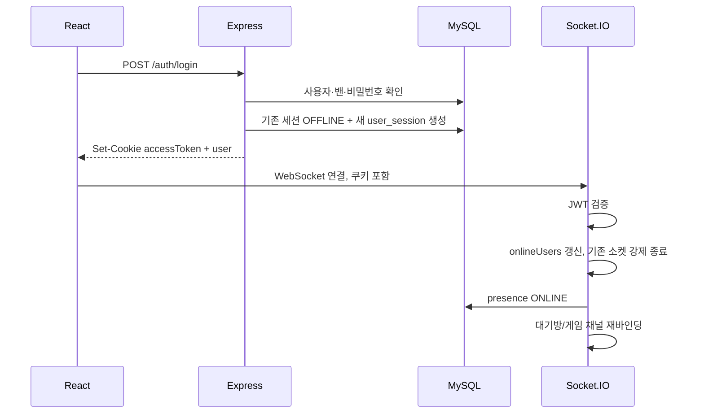
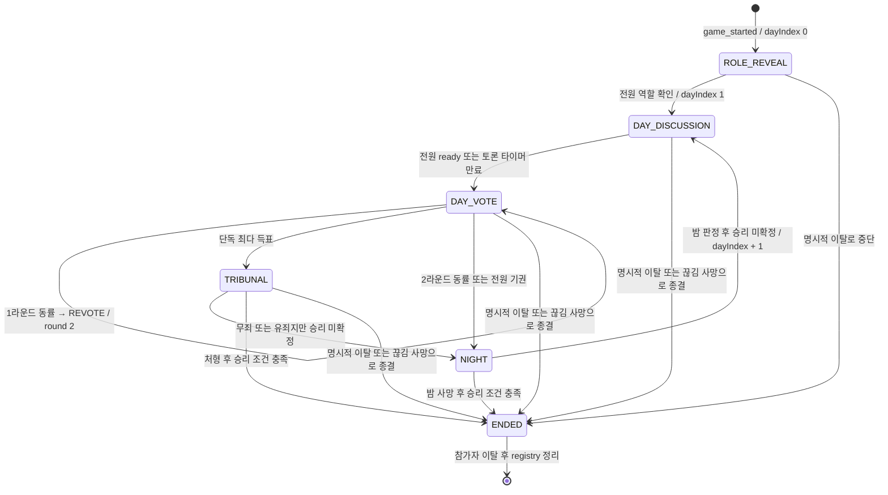
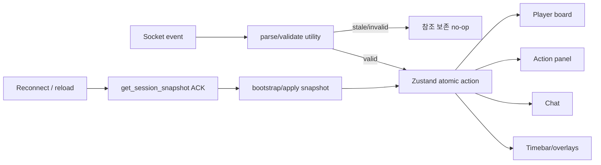
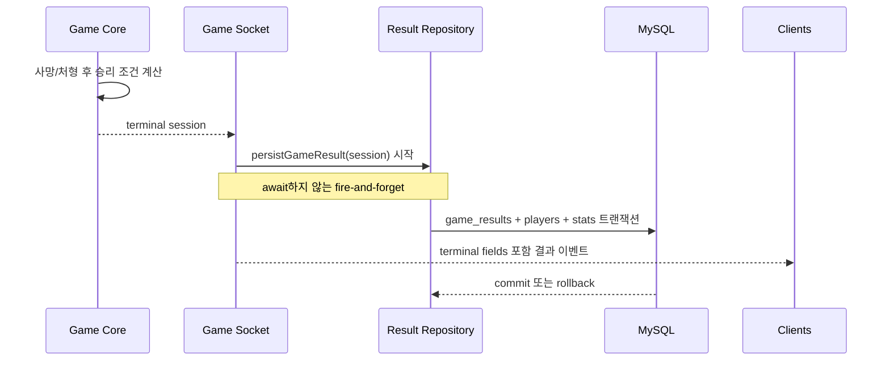

# Joker 프로젝트 모듈 구조·데이터 흐름·핵심 API 보고서

> 작성 기준: 2026-09-04 현재 로컬 워킹트리  
> 범위: 프런트엔드, 백엔드, 데이터베이스, Socket.IO 실시간 통신, 특히 인게임 상태 머신  
> 주의: 분석 시점에 인게임 관련 미커밋 변경 파일이 존재하므로, 본 문서는 Git `HEAD`가 아니라 **현재 파일 시스템의 코드**를 기준으로 한다.

## 1. 요약

이 프로젝트는 React 19/Vite 프런트엔드와 Express 5/Socket.IO 백엔드, MySQL/Sequelize 영속 계층으로 구성된 실시간 소셜 추리 게임이다. 일반 계정·프로필·친구·전적 조회는 REST API가 담당하고, 방 생성부터 게임 시작·낮 투표·재판·밤 행동·채팅·재접속까지의 실시간 흐름은 Socket.IO가 담당한다.

인게임의 핵심 설계는 다음과 같다.

- 백엔드 `game-core/gameSession.js`의 메모리 세션이 게임 규칙과 상태의 단일 진실 원천이다.
- `socket/gameSession.js`는 인증된 소켓 요청을 검증하고 core 함수를 호출한 뒤, ACK와 참가자별/전체 이벤트를 전달한다.
- 프런트엔드 Zustand `ingameStore`는 서버가 보낸 초기 상태, 이벤트, 재접속 스냅샷을 검증해 화면 상태로 투영한다.
- 비밀 정보는 뷰어별로 분리한다. 다른 참가자의 역할·투표 원문·밤 행동 대상은 공용 payload에 포함하지 않는다.
- 게임 종료 결과만 MySQL에 저장된다. 진행 중 방과 세션은 프로세스 메모리에만 존재한다.

현재 구현은 도메인 경계와 보안형 payload 설계가 비교적 명확하고 테스트 범위도 넓다. 반면 운영 관점에서는 단일 프로세스 메모리 의존, Socket 인증의 세션/밴 재검증 누락, 일부 재접속 교착 가능성, `player_eliminated` 프런트 미구독, fire-and-forget 전적 저장이 주요 위험이다.

## 2. 기술 구성과 실행 구조

| 영역 | 주요 기술 | 역할 |
|---|---|---|
| 프런트엔드 | React 19, React Router 7, Zustand 5, Socket.IO Client 4, Framer Motion, Tailwind/Vite | 화면, 로컬 UI 상태, 실시간 이벤트 투영 |
| 백엔드 HTTP | Node.js, Express 5 | 인증·프로필·친구·전적 REST API |
| 백엔드 실시간 | Socket.IO 4 | 접속 상태, 방/매칭, 인게임 이벤트 |
| 게임 규칙 | 순수 JavaScript 모듈 | 역할 배정, 상태 머신, 투표/밤 판정, 승리 조건 |
| 영속 계층 | Sequelize 6, MySQL 8.4 | 사용자, 세션, 친구, 통계, 종료 게임 기록 |
| 배포 | Docker Compose, Nginx 기반 프런트 이미지 | DB → 백엔드 → 프런트 순으로 구성 |

백엔드 기동 순서는 `backend/index.js`에서 환경변수 로드 → Sequelize 모델 초기화 → Express 미들웨어/라우터 결합 → HTTP 서버에 Socket.IO 부착 → DB `sync({ force:false })` 성공 후 listen 순이다. DB 연결 또는 모델 초기화가 실패하면 HTTP 서버만 살아 있는 부분 기동을 허용하지 않고 프로세스를 종료한다.

## 3. 전체 아키텍처



### 3.1 백엔드 모듈

| 경로 | 책임 | 주요 상태/의존성 |
|---|---|---|
| `backend/index.js` | 애플리케이션 조립·기동 | Express, HTTP, Sequelize, Socket.IO |
| `backend/routes/` | URL과 인증 미들웨어/컨트롤러 연결 | `/auth`, `/user`, `/friends`, `/game` |
| `backend/controller/` | HTTP 입력/응답 경계 | 상태 코드, JSON 응답 |
| `backend/service/` | 인증·친구·presence·동시접속 업무 규칙 | 트랜잭션 조합, 정책 |
| `backend/repositories/` | Sequelize 쿼리와 영속 트랜잭션 | User, Friend, GameResult 모델 |
| `backend/models/` | DB 스키마와 관계 | 도메인별 재귀 로딩 |
| `backend/socket/socket.js` | 소켓 인증·단일 접속·presence·하위 핸들러 등록 | `onlineUsers: Map<uuid,socketId>` |
| `backend/socket/matchmaking.js` | 빠른 매칭, 공개/코드 방, 준비, 게임 시작 | 방/큐 관련 메모리 Map |
| `backend/socket/gameSession.js` | 인게임 요청/ACK/방송, 타이머, 재접속 유예, 결과 저장 연결 | 턴·낮·유예 타이머 Map |
| `backend/game-core/gameSession.js` | 인게임 canonical 상태와 규칙 | 세션/플레이어 역매핑 Map |
| `backend/game-core/roleComposition.js` | AUTO/CUSTOM 역할 구성 검증·해석 | 역할 수 정책 |

백엔드는 전형적인 HTTP 계층 구조와 별도로 `socket → game-core` 경로를 둔다. 인게임에서는 서비스/리포지토리 계층을 매 이벤트마다 거치지 않고, 게임 core가 메모리 상태를 동기적으로 변경한다. DB는 게임 진행 중 상태가 아니라 종료 결과 저장에만 관여한다.

### 3.2 프런트엔드 모듈

| 경로 | 책임 |
|---|---|
| `frontend/src/app/` | Router와 앱 최상위 조립 |
| `frontend/src/shared/api/` | 쿠키 포함 REST `fetch` 래퍼 |
| `frontend/src/shared/socket/` | 현재 Socket.IO 인스턴스 싱글턴과 구독 |
| `frontend/src/shared/hooks/useSocket.js` | 로그인 상태에 따른 소켓 생성·종료, 강제 로그아웃 처리 |
| `frontend/src/domains/auth/` | 로그인·회원가입·인증 상태 |
| `frontend/src/domains/lobby/` | 로비와 친구 목록 |
| `frontend/src/domains/game/mode/` | 게임 방식 선택, 공개방/초대코드 진입 |
| `frontend/src/domains/game/setup/` | 방 설정과 역할 구성 payload 생성 |
| `frontend/src/domains/game/matching/` | 대기방 roster, 준비, 방장, 시작 |
| `frontend/src/domains/game/ingame/` | 인게임 화면·상태·행동·실시간 동기화 |
| `frontend/src/domains/game/result/` | 전적 결과 화면 |
| `frontend/src/domains/user`, `settings`, `store` | 계정, 설정, 상점 UI |

### 3.3 프런트 인게임 내부 구조

| 하위 모듈 | 핵심 역할 |
|---|---|
| `pages/InGamePage.jsx` | 보드, 채팅, 액션 패널, 타임바, 각종 오버레이 조합 |
| `components/board/` | 참가자 카드와 생존/연결 상태 표시 |
| `components/actions/` | 낮 투표·재판·밤 행동 컨트롤 |
| `components/chat/` | 낮 공개 채팅과 역할 채팅 UI |
| `components/roleReveal`, `phaseEntrance`, `nightTurn` | 역할/페이즈/턴 연출 |
| `hooks/useGameSessionSocketEvents.js` | 전역 인게임 상태 변경 이벤트 구독 |
| `hooks/useInGame*Submit/Resolve.js` | 각 요청의 ACK, timeout, stale 응답 방어 |
| `hooks/useInGameSessionSnapshotSync.js` | 최초 진입·재연결 시 서버 스냅샷 복원 |
| `store/ingameStore.js` | `gameId`, canonical UI state, 적용 액션 |
| `store/applySessionSnapshot.js` | 스냅샷 검증·bootstrap·병합 |
| `utils/parse*`, `compute*`, `create*Controller` | 외부 payload 정규화, 순수 상태 전이, 요청 세대 관리 |
| `constants/` | 역할 표시, 레이아웃, 이미지, 액션 문구 |

컴포넌트가 직접 서버 상태를 판단하기보다, 전용 훅과 순수 유틸이 payload를 검증하고 Zustand action이 원자적으로 반영한다. UI는 `phase`, `dayPhase`, `self`, `players`, `nightTurnRole` 등의 projection만 읽는다.

## 4. 주요 데이터 저장소

### 4.1 서버 메모리

| 소유 모듈 | 저장소 | 의미 |
|---|---|---|
| `socket/socket.js` | `onlineUsers` | 사용자별 canonical 소켓 ID |
| `socket/matchmaking.js` | `matchmakingQueue` | 빠른 매칭 대기열 |
| 〃 | `gameRooms` | 시작 전 대기방 |
| 〃 | `playerRoom` | 사용자 → 대기방 역매핑 |
| 〃 | `pendingRoomTransitions` | 방 생성/참가 중복 요청 잠금 |
| 〃 | `pendingRoomRemovals` | 대기방 재접속 유예 |
| `game-core/gameSession.js` | `gameSessions` | 게임 ID → canonical GameSession |
| 〃 | `playerSession` | 사용자 → 활성 게임 역매핑 |
| 〃 | `roomGameSession` | 방 → 활성 게임 역매핑 |
| `socket/gameSession.js` | `nightTurnRuns` | 게임별 밤 역할 턴 타이머 |
| 〃 | `dayPhaseRuns` | 게임별 낮 토론/투표 타이머 |
| 〃 | `disconnectGraceRuns` | 게임·사용자별 재접속 유예 |

이 상태들은 Redis나 DB로 공유되지 않는다. 따라서 현재 구조는 **백엔드 단일 인스턴스**와 **프로세스 수명 내 복구**를 전제로 한다.

### 4.2 GameSession 핵심 필드

```text
GameSession
├─ id, roomId, channelId, startedAt
├─ phase, dayIndex, dayPhase
├─ jokerCount, roleComposition, timerSettings
├─ players: Map<uuid, { uuid, nickname, role, alive, deathReason? }>
├─ roleRevealAcks: Set<uuid>
├─ nightActions: Map<uuid, targetUuid|null>
├─ nightResolution
├─ dayVoteReadyUuids: Set<uuid>
├─ dayVotes: Map<uuid, targetUuid|null>
├─ dayVoteRound, dayVoteExcludedUuids, dayVoteResolution
├─ tribunal: { defendantUuid, votes, resolved, ... } | null
├─ jokerChatRateLimit, dayChatRateLimit, deadChatRateLimit
├─ forfeitedUuids, detachedUuids
└─ winResult, endedAt
```

`null` 대상은 밤 행동의 SKIP 또는 낮 투표의 기권이다. 제출 완료 여부는 값이 아니라 `Map.has(uuid)`로 판정해 미제출과 명시적 기권을 구분한다.

### 4.3 MySQL 영속 데이터

| 도메인 | 테이블 |
|---|---|
| 사용자·인증 | `users`, `user_sessions`, `user_bans`, `login_history`, `password_reset_tokens`, `account_find_requests` |
| 사용자 상태 | `online_presence`, `user_stats` |
| 친구 | `friend_requests`, `friendships` |
| 게임 | `game_results`, `game_result_players`, `concurrent_snapshots` |
| 운영 | `traffic_logs` |

게임 결과 저장은 `game_results`, `game_result_players`, `user_stats`를 하나의 DB 트랜잭션으로 처리한다. `game_results.id` PK가 중복 저장과 통계 이중 증가를 방지한다.

## 5. 주요 데이터 흐름

### 5.1 인증과 소켓 연결



REST 인증은 JWT 서명뿐 아니라 `user_sessions.is_online`과 활성 밴을 매 요청마다 DB에서 검증한다. 반면 Socket.IO handshake는 현재 JWT 서명만 검증한다. 이 차이는 위험 항목에서 별도로 다룬다.

### 5.2 방 생성에서 게임 시작까지

1. 설정 화면이 `create_room` payload를 만든다.
2. 서버가 access type, 정원, 광대 수, 타이머, 역할 구성 값을 검증한다.
3. 사용자 조회와 Socket.IO room 가입을 완료한 후에만 `gameRooms`/`playerRoom`을 커밋한다.
4. 참여자는 `set_ready`로 본인의 준비 상태만 바꾼다.
5. 방장이 `start_game`을 요청한다.
6. 서버는 최소 인원·역할 구성·전원 준비·모든 참가자의 연결/room 가입을 사전 확인한다.
7. `prepareGameSession`으로 역할이 배정된 후보를 만들되 아직 registry를 변경하지 않는다.
8. 각 참가자에게 보낼 개인화 `game_started` payload를 미리 생성한다.
9. `commitGameSession` 후 대기방 registry를 제거하고 각 참가자에게 자신의 역할만 포함된 payload를 보낸다.

초기 상태는 `phase=ROLE_REVEAL`, `dayIndex=0`이다.

### 5.3 인게임 상태 머신



#### 역할 공개

- 참가자별 `game_started.state.self`에만 `role`, `team`, 필요 시 JOKER `allies`가 포함된다.
- 전원이 `acknowledge_role_reveal`을 완료하면 최초 낮으로 진입한다.
- 첫 진행 페이즈는 NIGHT가 아니라 `DAY / DAY_DISCUSSION / dayIndex=1`이다.

#### 낮 토론과 투표

- 낮 진입 시 `dayVoteReadyUuids`, `dayVotes`, 라운드, 제외 후보가 초기화된다.
- 생존자 전원이 `ready_for_day_vote`를 보내거나 토론 시간이 만료되면 `DAY_VOTE`가 열린다.
- 투표 대상은 생존 참가자이며, 자기 자신과 재투표 제외 대상은 선택할 수 없다.
- 1라운드 공동 최다는 `REVOTE`; 동점자들은 2라운드 후보에서 제외된다.
- 2라운드 동률 또는 유효 표 없음은 재판 없이 NIGHT로 전이한다.
- 단독 최다 득표자는 TRIBUNAL 피고가 된다. 개별 ballot은 공개되지 않는다.

#### 재판

- 피고를 제외한 생존 참가자가 `GUILTY` 또는 `NOT_GUILTY`를 제출한다.
- `guilty > notGuilty`일 때만 유죄이며, 동수는 무죄다.
- 유죄면 피고를 처형하고 역할을 `executedRole`로 공개한다.
- 승리 조건이 충족되지 않으면 같은 `dayIndex`의 NIGHT로 이동한다.

#### 밤 행동

밤 턴 순서는 항상 `JOKER → DOCTOR → GUARD → WITCH_HUNTER`다. 해당 역할의 생존자가 없어도 턴 시작/종료 이벤트를 동일한 형태로 방송하고, 빈 역할 턴은 제한시간의 20~60% 무작위 지연 후 종료해 생존 정보를 타이밍으로 노출하지 않도록 한다.

| 역할 | 팀 | 사용 가능 시점 | 대상 | 복수 보유자 판정 | 결과 |
|---|---|---|---|---|---|
| JOKER | JOKER | 모든 밤 | 생존자, 동료 선택은 성공 no-op | 최다득표, 동률이면 없음 | 암살 |
| DOCTOR | CITIZEN | 모든 밤 | 생존자, 자기 자신 허용 | 만장일치 | 암살 보호 |
| GUARD | CITIZEN | 모든 밤 | 생존자, 자기 자신 불가 | 만장일치 | 대상의 실제 역할 개인 확인 |
| WITCH_HUNTER | CITIZEN | `dayIndex >= 2` | 사망자 | 만장일치 | 대상의 실제 역할 개인 확인 |
| CITIZEN | CITIZEN | 없음 | 없음 | 해당 없음 | 해당 없음 |

밤 판정 순서는 보호 대조 → 사망 확정 → 사망자의 잔여 행동 제거 → 승리 재평가다. 보호 성공 시 생존 JOKER에게만 `{actionType:'ASSASSINATE', success:false}`를 보내고 보호자/대상은 노출하지 않는다.

#### 승리 조건

- 생존 JOKER가 0명이면 `CITIZEN` 승리.
- 생존 JOKER 수가 생존 비-JOKER 수 이상이면 `JOKER` 승리.
- 처형, 밤 사망, 재접속 유예 만료에 의한 사망 직후 동일한 조건을 재평가한다.

### 5.4 서버 → 프런트 상태 동기화



프런트는 이벤트가 도착할 때 캡처된 오래된 React 상태를 신뢰하지 않고, Zustand의 현재 `gameId`, `dayIndex`, roster를 다시 읽어 검증한다. 요청 훅도 socket 참조, gameId, dayIndex, 요청 세대를 비교해 늦은 ACK가 새 상태를 덮지 못하게 한다.

## 6. REST API 명세

### 6.1 공통 계약

- 기본 주소: 프런트의 `VITE_API_BASE_URL`; 백엔드 기본 포트는 `4000`.
- 인증: `accessToken` HttpOnly 쿠키.
- 쿠키: `SameSite=Lax`, production에서 `Secure=true`.
- JWT 만료: 1일.
- `rememberMe=true`: 쿠키 `maxAge`는 30일이지만 JWT는 1일이므로 실제 인증 지속 시간은 최대 1일이다.
- 보호 API는 JWT의 `uuid`, `role`, `sessionId`와 DB의 활성 세션/밴을 확인한다.
- 일반 성공 형태: `{ success: true, data?: ..., message?: string }`.
- 일반 실패 형태: `{ success: false, message: string, error?: stack }`; production에서는 `error` 생략.

### 6.2 엔드포인트

| Method / Path | 인증 | 요청 | 성공 응답 요약 | 대표 실패 |
|---|---:|---|---|---|
| `POST /auth/signup` | X | `{email,password,nickname}` | `200`, 회원가입 메시지 | `400` 누락, `409` 이메일/닉네임 중복 |
| `POST /auth/login` | X | `{email,password,rememberMe?}` | `200`, 쿠키 설정, `{data:{user:{uuid,nickname,role}}}` | `400`, `401`, `403` 밴, `423` 잠금 |
| `GET /auth/me` | O | 없음 | `{data:{uuid,role}}` | `401`, `403` |
| `POST /auth/logout` | O | 없음 | DB 세션 offline, 쿠키 제거 | `401` |
| `GET /user/me/profile` | O | 없음 | nickname, image, reputation, title, 전적 통계 | `404` 사용자 없음 |
| `PATCH /user/me/nickname` | O | `{nickname}` | 변경 메시지 | `400` 빈 값, `409` 중복 |
| `PATCH /user/me/password` | O | `{currentPassword,newPassword}` | 변경 메시지 | `400`, `401` 현재 비밀번호 불일치 |
| `GET /friends` | O | 없음 | 친구 배열 `{id,name,profile,status,online,isFavorite}` | 공통 오류 |
| `GET /friends/search?q=...` | O | query `q` | 사용자 배열 `{id,name,profile}` | 빈 검색은 빈 배열 |
| `GET /friends/requests/incoming` | O | 없음 | 요청 배열 `{request_id,id,name,profile,message,created_at}` | 공통 오류 |
| `POST /friends/requests` | O | `{receiverId}` | 요청 전송 메시지 | `400` 자기 자신/누락, `409` 중복·이미 친구 |
| `PUT /friends/requests/:id/accept` | O | path id | 수락 메시지, 상대에게 실시간 알림 | `400`, `403`, `404`, `409` |
| `PUT /friends/requests/:id/decline` | O | path id | 거절 메시지, 상대에게 실시간 알림 | `400`, `403`, `404`, `409` |
| `GET /game/:gameId` | O | path gameId | 종료 게임 헤더와 참가자 결과 | `400` 빈 ID, `404` 기록 없음 |

`GET /game/:gameId`의 `data`는 다음 필드를 가진다.

```json
{
  "game_id": "uuid",
  "room_id": "uuid|null",
  "winner": "CITIZEN|JOKER|NONE",
  "win_reason": "ALL_JOKERS_ELIMINATED|JOKER_PARITY_REACHED|ABORTED|null",
  "started_at": "datetime",
  "ended_at": "datetime",
  "day_index": 3,
  "player_count": 8,
  "settings": {},
  "completed": true,
  "players": [
    {
      "uuid": "uuid",
      "nickname_snapshot": "name",
      "role": "JOKER",
      "team": "JOKER",
      "won": true,
      "is_alive": true,
      "death_reason": null
    }
  ]
}
```

## 7. Socket.IO 공통 계약

### 7.1 연결과 신원

- 클라이언트는 `withCredentials=true`, WebSocket transport로 연결한다.
- handshake 쿠키의 `accessToken` JWT를 검증해 `socket.data.user`에 저장한다.
- 동일 uuid의 새 소켓이 연결되면 `onlineUsers`를 새 소켓으로 먼저 바꾼 후 기존 소켓에 `force_disconnect`를 전송하고 끊는다.
- 모든 주요 mutation은 `onlineUsers.get(uuid) === socket.id`인지 확인한다. 교체된 오래된 소켓은 `STALE_SOCKET`으로 거부한다.
- 요청 payload의 `uuid`, `role`, `team`, `alive` 등 권한 필드는 사용하지 않는다. 인증된 uuid와 canonical 세션만 신뢰한다.
- ACK 실패의 공통 형태는 `{ok:false, code, message}`다. registry 불일치 등 내부 코드는 외부에 `INTERNAL_ERROR`로 정규화한다.

### 7.2 매칭·대기방 이벤트

| 방향 | 이벤트 | payload | ACK/발행 결과 |
|---|---|---|---|
| C→S | `join_matchmaking` | 없음 | 비활성 시 `matchmaking_disabled`; 활성 시 queued/found |
| C→S | `leave_matchmaking` | 없음 | ACK 없음 |
| C→S | `create_room` | 방 설정 객체 | ACK `{ok:true,room}` 또는 `{ok:false,code?,message}` |
| C→S | `get_public_rooms` | `{}` | ACK `{ok:true,rooms}` |
| C→S | `join_public_room` | `{roomId}` | 성공 `room_joined`, 실패 `room_join_failed` |
| C→S | `join_room_by_code` | `{roomCode,roomId?}` | 성공 `room_joined`, 실패 `room_join_failed` |
| C→S | `get_current_room` | `{}` | ACK `{ok:true,room:null|Room,pending?}` |
| C→S | `set_ready` | `{isReady:boolean}` | ACK `{ok:true,isReady,canStart}` |
| C→S | `start_game` | `{}` | ACK `{ok:true,gameId}` 후 참가자별 `game_started` |
| C→S | `leave_room` | 없음 | `player_left_room`, 필요 시 `host_changed` |
| C→S | `delete_room` | 없음 | `room_deleted` |
| S→C | `public_rooms_updated` | `{rooms:[...]}` | 전체 소켓에 공개방 목록 갱신 |

방 설정 payload의 canonical 필드는 다음과 같다.

```json
{
  "accessType": "open|code",
  "maxPlayers": 4,
  "jokerCount": 1,
  "lightsOut": false,
  "soulBetting": false,
  "dayDiscussionTime": 60,
  "dayVoteTime": 60,
  "nightActionTime": 60,
  "roleNightActionTimes": {
    "JOKER": 30,
    "DOCTOR": 30,
    "GUARD": 30,
    "WITCH_HUNTER": 30
  },
  "voteReveal": false,
  "roleCompositionMode": "auto|custom",
  "roleCounts": {
    "JOKER": 1,
    "DOCTOR": 1,
    "GUARD": 1,
    "WITCH_HUNTER": 0
  }
}
```

`roleNightActionTimes`는 선택이고, 값이 없는 역할은 `nightActionTime`으로 폴백한다. `roleCounts`는 CUSTOM에서만 허용되며 CITIZEN 수는 실제 시작 인원에서 파생한다. 특수 역할별 상한은 2명이다.

## 8. 인게임 Socket API 명세

### 8.1 클라이언트 요청 이벤트

| 이벤트 | 요청 payload | 성공 ACK | 주요 상태 변화/실패 |
|---|---|---|---|
| `acknowledge_role_reveal` | `{gameId}` | `{ok:true}` | 전원 확인 시 `ROLE_REVEAL→DAY`; `INVALID_PHASE`, `NOT_IN_SESSION` |
| `ready_for_day_vote` | `{gameId}` | `{ok:true,readyCount,requiredCount}` | 전원 준비 시 `DAY_DISCUSSION→DAY_VOTE`; `ACTOR_NOT_ALIVE`, `INVALID_DAY_PHASE` |
| `submit_night_action` | `{gameId,targetId:string|null}` | `{ok:true}` | 현재 역할 턴 행동 저장; `NOT_YOUR_TURN`, `NOT_ELIGIBLE`, 대상 오류 |
| `resolve_night` | `{gameId}` | `{ok:true}` | 모든 행동 판정, 사망/승리/다음 낮 적용; `ACTIONS_PENDING`, `NIGHT_ALREADY_RESOLVED` |
| `cast_day_vote` | `{gameId,targetId:string|null}` | `{ok:true}` | 현재 라운드 표 저장/덮어쓰기; 기권은 null |
| `resolve_day_vote` | `{gameId,dayIndex}` | `{ok:true,gameId,dayIndex,outcome,tribunalTargetUuid}` | `REVOTE`, `TRIBUNAL`, `NIGHT`; 미완료면 `ACTIONS_PENDING` |
| `cast_tribunal_vote` | `{gameId,dayIndex,vote:'GUILTY'|'NOT_GUILTY'}` | `{ok:true}` | 피고 제외 생존자의 1회 투표 |
| `resolve_tribunal_vote` | `{gameId,dayIndex}` | `{ok:true,gameId,dayIndex,outcome,counts,executedUuid}` | 모든 재판 표 판정; 미완료면 `TRIBUNAL_VOTES_INCOMPLETE` |
| `submit_game_chat_message` | `{gameId,text}` | `{ok:true}` | DAY 생존자 공개 채팅 |
| `submit_joker_chat_message` | `{gameId,text}` | `{ok:true}` | NIGHT 역할 채팅 wire API; 현재 구현은 역할 채널로 일반화됨 |
| `get_session_snapshot` | `{gameId?}` | `{ok:true,...snapshot}` | 현재 canonical 상태 복원; bootstrap 시 gameId 생략 가능 |
| `leave_game_session` | `{gameId}` | `{ok:true}` | 진행 중 게임은 중단·정리, 종료 게임은 참가자 detach |

참고로 프런트는 `cast_day_vote`에 `dayIndex`도 보내지만 현재 서버 핸들러/core는 이 필드를 읽지 않는다. 실제 서버 계약은 위 표처럼 `gameId`와 `targetId`다.

### 8.2 서버 발행 이벤트

| 이벤트 | 대상 | payload 핵심 |
|---|---|---|
| `game_started` | 참가자별 개별 | `{gameId,state:{id,phase,dayIndex,players,self}}` |
| `game_phase_changed` | 세션 전체 | `{gameId,phase,dayIndex}` |
| `day_phase_changed` | 세션 전체 | `{gameId,dayIndex,dayPhase,round}` |
| `night_turn_started` | 세션 전체 | `{gameId,dayIndex,role,deadline}` |
| `night_turn_ended` | 세션 전체 | `{gameId,dayIndex,role}` |
| `day_vote_resolved` | 참가자 개별 전달 | `{gameId,dayIndex,phase,round,outcome,tribunalTargetUuid,publicVoteCount,publicAbstainCount,revoteExcludedUuids}` |
| `tribunal_vote_resolved` | 참가자 개별 전달 | `{gameId,dayIndex,phase,defendantUuid,outcome,counts,executedUuid,executedRole}` + 종료 시 terminal 필드 |
| `night_actions_resolved` | 참가자 개별 전달 | `{gameId,dayIndex}` |
| `night_action_result` | 해당 역할 본인만 | `{gameId,dayIndex,actionType,...privateResult}` |
| `night_result_applied` | 참가자 개별 전달 | `{gameId,phase,dayIndex,players:[{uuid,alive}],victimUuid,deathReveals}` + 종료 시 terminal 필드 |
| `player_eliminated` | 세션 전체 | 재접속 유예 만료 사망과 roster; 종료 시 terminal 필드 |
| `day_chat_message_received` | DAY 채널 수신자 | `{gameId,messageId,senderUuid,nickname,text,sentAt,dayIndex}` |
| `joker_chat_message` | 같은 역할 채널 수신자 | `{gameId,senderUuid,text,messageId,sentAt}` |
| `game_ended` | 세션 전체 | `{gameId,reason}`; 명시적 종료/정리 경로 |

`outcome` 열거값은 낮 투표에서 `REVOTE | TRIBUNAL | TIE | ABSTAINED`, 재판에서 `GUILTY | NOT_GUILTY`다.

### 8.3 `game_started` 비밀 정보 계약

```json
{
  "gameId": "game-uuid",
  "state": {
    "id": "game-uuid",
    "phase": "ROLE_REVEAL",
    "dayIndex": 0,
    "players": [
      { "uuid": "p1", "nickname": "A", "themeIndex": 3 }
    ],
    "self": {
      "uuid": "p1",
      "nickname": "A",
      "role": "JOKER",
      "team": "JOKER",
      "allies": ["p2"]
    }
  }
}
```

- `players[]`에는 role/team이 없다.
- `self.allies`는 JOKER에게만 존재하고 다른 JOKER uuid만 포함한다.
- 참가자 색상 `themeIndex`는 gameId에서 결정적으로 생성돼 모든 뷰어에게 일치한다.

### 8.4 세션 스냅샷 계약

```json
{
  "ok": true,
  "gameId": "game-uuid",
  "phase": "DAY",
  "dayIndex": 2,
  "dayPhase": "DAY_VOTE",
  "players": [
    {
      "uuid": "p1",
      "nickname": "A",
      "isAlive": true,
      "themeIndex": 3,
      "isConnected": true
    }
  ],
  "self": {
    "uuid": "p1",
    "nickname": "A",
    "role": "CITIZEN",
    "team": "CITIZEN",
    "hasActedThisPhase": false
  },
  "nightResult": {
    "dayIndex": 2,
    "victimUuid": "p4|null",
    "deathReveals": [{ "victimUuid": "p4", "source": "JOKER" }]
  },
  "dayVoteResolution": {
    "round": 1,
    "outcome": "REVOTE",
    "tribunalTargetUuid": null,
    "publicVoteCount": 6,
    "publicAbstainCount": 0,
    "revoteExcludedUuids": ["p2", "p3"]
  },
  "tribunal": {
    "defendantUuid": "p2",
    "resolved": false
  },
  "winResult": {
    "winner": "CITIZEN"
  }
}
```

`dayPhase`, `nightResult`, `dayVoteResolution`, `tribunal`, `winResult`는 현재 상태에 따라 선택적으로 존재한다. 스냅샷은 타 참가자의 역할, 투표 원문, 밤 행동 원문을 포함하지 않는다.

### 8.5 채팅 정책

- 최대 150 JavaScript code unit.
- 채널별 최소 전송 간격 500ms.
- CRLF/CR은 LF로 정규화하고 앞뒤 공백을 제거한다.
- C0/C1 제어문자, DEL, bidi 제어문자를 거부한다.
- DAY 공개 채팅은 생존자만 발행할 수 있지만 사망자도 수신한다.
- NIGHT에는 공개 채팅을 허용하지 않는다.
- 역할 채팅은 같은 역할 수신자에게만 전달하며, JOKER 사망자는 JOKER 채널 수신을 유지한다.
- 메시지 ID와 발송 시각은 서버가 생성한다.
- 채팅 내용은 DB에 저장하지 않는다.

## 9. 종료와 전적 저장 흐름



정상 승패 확정은 `winner=CITIZEN|JOKER`, `completed=true`로 저장한다. 명시적 이탈로 중단된 게임은 `winner=NONE`, `win_reason=ABORTED`, `completed=false`다. 참가자별 `death_reason`은 `ASSASSINATION | EXECUTION | DISCONNECT | null`이다.

## 10. 재접속과 장애 처리

### 10.1 서버 측

- 소켓 재연결 시 활성 대기방과 GameSession channel을 재가입한다.
- 대기방 disconnect는 기본 15초 동안 제거를 유예한다.
- 진행 중 GameSession disconnect는 즉시 게임을 끝내지 않고 사용자별 유예를 둔다.
- 자신의 NIGHT 턴 중 disconnect면 이미 방송된 턴 deadline까지만 기다린다.
- 그 외에는 끊긴 top-level phase가 바뀌는 경계에서 유예를 만료해 해당 참가자를 사망 처리한다.
- 유예 만료 전에 스냅샷 요청/재연결이 확인되면 타이머를 취소한다.
- 유예 만료로 배제된 사용자는 같은 uuid로 다시 접속해도 해당 세션에 복귀할 수 없다.

### 10.2 프런트 측

- 새로고침으로 Zustand가 비어 있으면 `/ingame` 마운트 후 `get_session_snapshot`을 gameId 없이 요청해 bootstrap할 수 있다.
- 연결된 상태에서 진입하거나 재연결되면 세대당 한 번 스냅샷을 요청한다.
- 다만 현재 전역 `disconnect` 핸들러는 인게임 store를 즉시 비우고 `/multiplay`로 이동한다. 일시적 네트워크 단절에서 서버 유예를 활용한 동일 화면 자동 복귀와는 동작이 충돌한다.

## 11. 강점

1. **게임 규칙과 전송 계층의 분리**  
   game-core가 Socket.IO 객체를 모르고, socket 계층은 역할/승리 규칙을 중복 구현하지 않는다.

2. **prepare → commit 신뢰 경계**  
   밤 판정, 낮 투표, 재판, 채팅에서 검증과 mutation을 분리하고 commit 직전에 canonical 상태를 재확인한다.

3. **비밀 정보 최소화**  
   참가자별 초기 payload, 개인 밤 결과, 공개 집계 payload가 분리되어 원시 ballot과 다른 역할 정보가 공용 이벤트에 섞이지 않는다.

4. **stale 이벤트 방어**  
   canonical socket ID, gameId/dayIndex 비교, 요청 generation, Zustand 참조 보존 no-op을 여러 층에서 적용한다.

5. **멱등성과 원자성 고려**  
   중복 준비/확인, 결과 DB 저장, 방 생성의 부분 실패, 타이머 지연 도착을 방어한다.

6. **폭넓은 자동 테스트**  
   규칙, payload 비밀성, 타이머, 재접속, DB 트랜잭션, 프런트 파서를 세밀하게 검증한다.

## 12. 위험과 개선 우선순위

### P0 — 진행/종료 상태 유실 가능성

#### 12.1 `player_eliminated`를 프런트에서 구독하지 않음

서버는 재접속 유예 만료 사망을 `player_eliminated`로 방송하지만, `useGameSessionSocketEvents`에는 이 이벤트의 리스너가 없다. 그 결과 다른 참가자의 disconnect 사망이 즉시 UI roster에 반영되지 않으며, 그 사망이 승리 조건을 만족시켜 세션이 `ENDED`가 된 경우에도 프런트가 종료 상태를 놓칠 수 있다.

추가로 이 이벤트의 `players` 필드는 비종료 시 `{uuid,alive}`, 종료 시 terminal 필드 병합으로 `{uuid,isAlive}`가 되어 형태가 달라진다.

권고:

- payload 필드를 하나의 형태(`isAlive` 권장)로 통일한다.
- 프런트 parser와 Zustand action을 추가한다.
- disconnect 사망으로 승리 확정되는 통합 테스트를 추가한다.

#### 12.2 ROLE_REVEAL·TRIBUNAL 재접속 교착 가능성

서버는 자신의 NIGHT 턴이 아닌 disconnect를 “다음 top-level phase 경계”까지 유예한다. 그러나 다음 phase로 가기 위해 해당 참가자의 입력이 필요한 구간이 있다.

- ROLE_REVEAL: 전원 ACK가 필요하지만 disconnect 참가자는 ACK할 수 없다.
- TRIBUNAL: 피고가 아닌 생존자 전원의 투표가 필요하며 재판 타이머가 없다.

두 경우 phase 경계가 생기지 않아 유예 만료도 일어나지 않는 순환 대기가 가능하다.

권고:

- ROLE_REVEAL과 TRIBUNAL에 명시적 deadline을 둔다.
- 만료 시 미응답자를 기권/배제한 뒤 canonical 경로로 전이한다.
- “disconnect → 미복귀 → 자동 진행” 시나리오를 end-to-end 테스트한다.

### P1 — 인증·운영 안정성

#### 12.3 Socket handshake가 DB 세션과 밴을 검증하지 않음

REST `verifyToken`은 `user_sessions.is_online`과 활성 밴을 조회하지만 `authenticateSocket`은 JWT 서명만 검증한다. 로그아웃되거나 다른 로그인으로 무효화된 세션, 로그인 후 밴 처리된 계정의 토큰이 만료 전까지 새 Socket 연결에 사용될 수 있다.

권고:

- Socket middleware에서도 `sessionId + uuid` 활성 세션과 밴을 검증한다.
- 장기 연결 중 밴/로그아웃 적용 정책도 정의하고 강제 disconnect 수단을 둔다.

#### 12.4 진행 상태가 단일 프로세스 메모리에만 존재

백엔드 재시작 시 대기방·게임·타이머가 모두 사라지고, 여러 인스턴스를 띄우면 각 인스턴스가 서로 다른 상태를 보게 된다. Socket.IO Redis adapter만 추가해도 core registry는 여전히 분리되므로 충분하지 않다.

권고:

- 당장은 단일 replica와 sticky session을 운영 제약으로 명시한다.
- 이후 GameSession event log/snapshot, 분산 lock/actor ownership, Socket.IO adapter를 함께 설계한다.

#### 12.5 전적 저장이 fire-and-forget이며 재시도 없음

종료 이벤트를 막지 않는 장점이 있지만 DB 일시 장애 시 로그만 남고 결과가 영구 유실될 수 있다. 종료 직후 `GET /game/:gameId`가 저장 완료 전 호출되어 일시적으로 404가 될 가능성도 있다.

권고:

- outbox/queue 또는 로컬 durable retry를 도입한다.
- 결과 화면은 저장 완료 이벤트를 받거나 제한된 재시도 정책을 사용한다.

#### 12.6 mutation 요청의 phase generation 결합이 일부 부족

`resolve_day_vote`와 재판 이벤트는 `dayIndex`를 검증하지만, 다음 이벤트들은 현재 phase/round 식별자를 요청 계약에 포함하지 않거나 서버가 무시한다.

- `cast_day_vote`: 프런트는 dayIndex를 보내지만 서버는 읽지 않으며 round도 없다.
- `ready_for_day_vote`: dayIndex가 없다.
- `submit_night_action`, `resolve_night`: dayIndex가 없다.

canonical phase 검사는 있으나, 이전 낮/라운드/밤의 늦은 재전송이 우연히 같은 종류의 다음 phase에 도착하면 현재 상태에 적용될 여지가 있다.

권고:

- 모든 mutation에 `gameId + dayIndex + phase/round 또는 phaseVersion`을 요구한다.
- core가 해당 generation을 검증한 후에만 Map을 변경하도록 통일한다.

### P2 — 제품 동작·유지보수

#### 12.7 프런트 disconnect 처리와 서버 재접속 유예 정책 불일치

프런트는 인게임 중 소켓이 끊기면 즉시 store를 비우고 `/multiplay`로 이동한다. 서버는 사용자를 활성 게임에 유지하므로 새 방 참가도 `ALREADY_IN_GAME`으로 거부될 수 있다. 새로고침 bootstrap 경로는 있지만 일반적인 일시 단절 UX는 복귀보다 이탈에 가깝다.

권고:

- disconnect 시 화면을 유지하고 “재연결 중” 상태를 표시한다.
- 재연결/스냅샷 성공 시 복원하고, `FORFEITED_FROM_SESSION` 또는 명시적 timeout일 때만 로비로 이동한다.

#### 12.8 rememberMe 계약 불일치

rememberMe 쿠키는 30일 보존되지만 내부 JWT는 1일 후 만료된다. 사용자 기대와 실제 로그인 지속 시간이 다르다.

권고: refresh token/세션 갱신을 도입하거나 쿠키 maxAge와 JWT 만료를 동일하게 맞추고 UI 문구를 일치시킨다.

#### 12.9 인게임 사용자 문구의 문자 깨짐

`useInGameActionPanel.js` 일부 주석과 오류 문구가 mojibake 상태다. 특히 낮 투표 판정 연결/timeout 오류가 실제 사용자에게 깨진 문자열로 표시될 수 있다.

권고: UTF-8 원문을 복구하고 기존 `check:utf8`가 “유효한 UTF-8로 인코딩된 mojibake”도 탐지할 수 있도록 대표 문구 테스트를 추가한다.

#### 12.10 소스 주석과 현재 구현의 불일치

일부 주석은 “인게임 실시간 갱신 훅 미구현”, “ROLE_REVEAL→NIGHT” 등 과거 상태를 설명하지만 실제 구현은 실시간 갱신이 존재하고 최초 전이는 DAY다. 코드 이해 시 오판 위험이 있다.

권고: 상태 머신 다이어그램을 canonical 문서로 두고 관련 주석을 정리한다.

#### 12.11 프런트 번들 크기

프로덕션 빌드는 성공했으나 단일 JS 번들이 약 735.5KB( gzip 약 221.6KB)로 Vite 500KB 경고를 넘는다.

권고: 라우트 단위 `lazy`/dynamic import, 대형 에셋/라이브러리 분리, bundle analyzer로 상위 모듈을 확인한다.

## 13. 검증 결과

분석 시점의 현재 워킹트리에서 다음 검증을 수행했다.

| 검증 | 결과 |
|---|---|
| 코드베이스 지식 그래프 | ready, 2,990 nodes / 4,537 edges |
| 백엔드 `npm test` | 953/953 통과, 실패 0 |
| 프런트엔드 `npm test` | 837/837 통과, 실패 0 |
| 프런트엔드 `npm run build` | 성공, 833 modules transformed |
| 빌드 경고 | JS chunk 735.54KB로 500KB 기준 초과 |

테스트 통과는 현재 명시된 단위/통합 계약이 유지됨을 뜻한다. 12장의 위험 중 일부는 테스트가 의도적으로 현재 동작을 고정하고 있거나, 아직 end-to-end 소비자 연결을 검증하지 않아 통과와 동시에 존재할 수 있다.

## 14. 주요 코드 위치

| 주제 | 파일 |
|---|---|
| 서버 진입점 | `backend/index.js` |
| Socket 연결·인증 | `backend/socket/socket.js` |
| 대기방/게임 시작 | `backend/socket/matchmaking.js` |
| 인게임 Socket 계약 | `backend/socket/gameSession.js` |
| 인게임 규칙/상태 머신 | `backend/game-core/gameSession.js` |
| 역할 구성 | `backend/game-core/roleComposition.js` |
| 전적 저장 | `backend/repositories/gameResult.repositories.js` |
| 인게임 화면 조립 | `frontend/src/domains/game/ingame/pages/InGamePage.jsx` |
| 프런트 canonical store | `frontend/src/domains/game/ingame/store/ingameStore.js` |
| 스냅샷 복원 | `frontend/src/domains/game/ingame/store/applySessionSnapshot.js` |
| 실시간 이벤트 투영 | `frontend/src/domains/game/ingame/hooks/useGameSessionSocketEvents.js` |
| 인게임 액션 orchestration | `frontend/src/domains/game/ingame/hooks/useInGameActionPanel.js` |
| 재접속 스냅샷 | `frontend/src/domains/game/ingame/hooks/useInGameSessionSnapshotSync.js` |

---

결론적으로 현재 코드는 **단일 서버 인스턴스에서 동작하는 서버 권위형 실시간 게임**으로 구조가 잘 잡혀 있다. 다음 개발 우선순위는 기능 추가보다 `player_eliminated` 소비 연결, ROLE_REVEAL/TRIBUNAL timeout, Socket 세션 재검증의 세 항목을 먼저 닫는 것이 합리적이다. 이 세 가지는 각각 상태 일관성, 게임 진행 가능성, 인증 경계를 직접 좌우한다.
